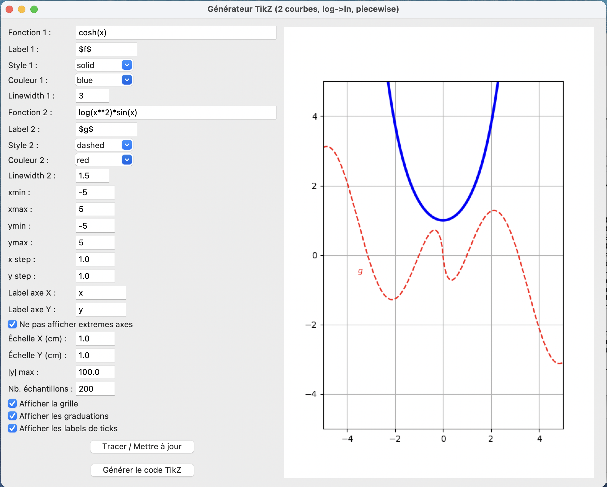
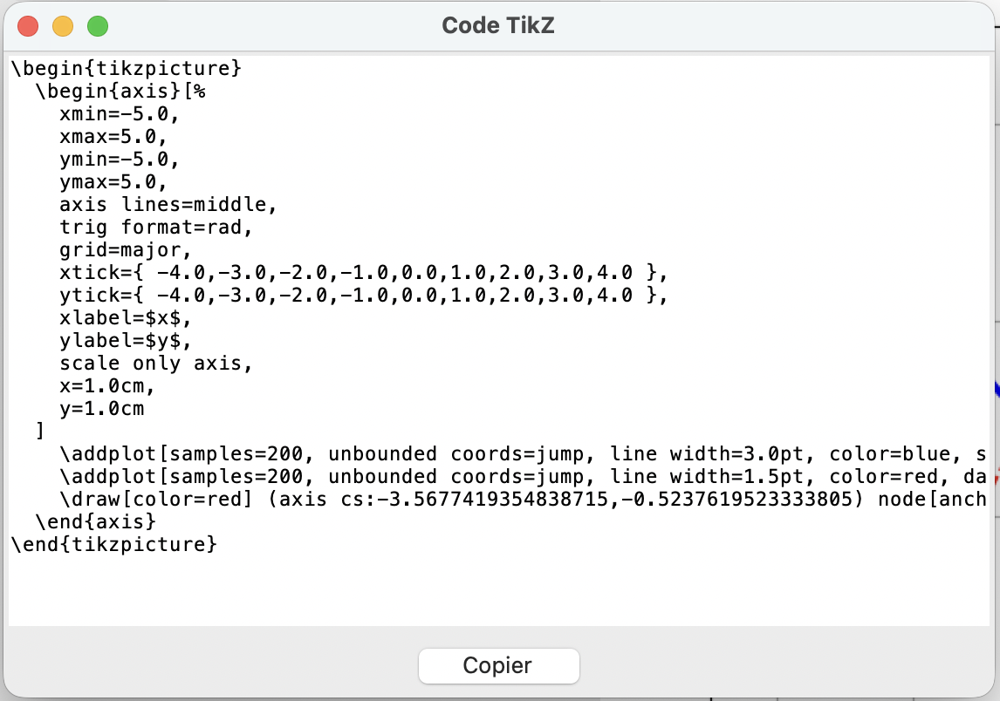

[](https://github.com/philipperackette/MakeTikz/actions/workflows/ci.yml) [](LICENSE)

# MakeTikz

## Français

Générateur interactif de code **TikZ/pgfplots** pour produire rapidement des figures mathématiques propres, avec une seconde application dédiée à l'**interpolation par points**.

**Version web :** https://huggingface.co/spaces/rackette/MakeTikz

### Aperçu

| Tracés symboliques (`plot_tikz_generator.py`) | Interpolation par points (`Lissage.py`) |
|:---:|:---:|
|  |  |

### Contenu

- `plot_tikz_generator.py` : générateur interactif de code TikZ/pgfplots (version bureau)
- `Lissage.py` : outil d'interpolation par points
- `hf_space/` : version web (Gradio) et moteur commun `make_tikz_engine.py`, utilisé aussi par la version bureau
- `tests/` : tests du moteur, de `Lissage.py` et des interfaces
- `Interface1.png`, `Interface2.png` : captures d'écran
- `LICENSE` : licence MIT

### Utilisation

Clonez le dépôt, installez les dépendances, puis lancez le script souhaité.

```bash
git clone https://github.com/philipperackette/MakeTikz.git
cd MakeTikz
pip install sympy numpy matplotlib scipy
python plot_tikz_generator.py
```

ou :

```bash
python Lissage.py
```

`plot_tikz_generator.py` utilise le moteur du dossier `hf_space/` : gardez le dossier à côté du script.

### Saisie des fonctions

`x^2` ou `x**2`, multiplication implicite (`2x`, `3sin(x)`), `sqrt`, `abs`, `exp`, `ln` ou `log` (logarithme népérien), `log10`, `log2`, fonctions trigonométriques et hyperboliques et leurs réciproques, `pi`, `e`, fonctions par morceaux avec `Piecewise((x+1, x<0), (x-1, True))`. Le code produit utilise les noms de pgfplots (`ln`, `abs`, `cosec`…) ; une fonction que pgfplots ne sait pas tracer (par exemple `gamma`) est signalée au lieu de produire un code qui ne compile pas.

### Tests

```bash
pip install -r requirements-dev.txt
ruff check .
python -m pytest tests
```

Les tests couvrent le moteur, les calculs de `Lissage.py` et le chargement des interfaces (Tkinter et Gradio). Si `pdflatex` est installé, ils compilent aussi le code produit avec pgfplots. GitHub Actions les lance à chaque push et pull request, sous Python 3.10 (version des Spaces Hugging Face) et 3.13, avec pdflatex.

### Public visé

- enseignants de mathématiques,
- étudiants,
- utilisateurs de LaTeX/TikZ souhaitant produire rapidement des graphiques exploitables.

---

## English

Interactive **TikZ/pgfplots** code generator for quickly producing clean mathematical figures, with a second application dedicated to **point interpolation**.

**Web version:** https://huggingface.co/spaces/rackette/MakeTikz

### Overview

| Symbolic plots (`plot_tikz_generator.py`) | Point interpolation (`Lissage.py`) |
|:---:|:---:|
|  |  |

### Contents

- `plot_tikz_generator.py`: interactive TikZ/pgfplots code generator (desktop version)
- `Lissage.py`: point interpolation tool
- `hf_space/`: web version (Gradio) and the shared engine `make_tikz_engine.py`, also used by the desktop version
- `tests/`: tests for the engine, `Lissage.py` and the interfaces
- `Interface1.png`, `Interface2.png`: screenshots
- `LICENSE`: MIT license

### Usage

Clone the repository, install the dependencies, then run the script you need.

```bash
git clone https://github.com/philipperackette/MakeTikz.git
cd MakeTikz
pip install sympy numpy matplotlib scipy
python plot_tikz_generator.py
```

or:

```bash
python Lissage.py
```

`plot_tikz_generator.py` uses the engine in `hf_space/`: keep that folder next to the script.

### Function syntax

`x^2` or `x**2`, implicit multiplication (`2x`, `3sin(x)`), `sqrt`, `abs`, `exp`, `ln` or `log` (natural log), `log10`, `log2`, trigonometric and hyperbolic functions and their inverses, `pi`, `e`, piecewise functions with `Piecewise((x+1, x<0), (x-1, True))`. The generated code uses pgfplots names (`ln`, `abs`, `cosec`…); a function pgfplots cannot draw (e.g. `gamma`) is reported instead of producing code that does not compile.

### Tests

```bash
pip install -r requirements-dev.txt
ruff check .
python -m pytest tests
```

The tests cover the engine, the `Lissage.py` computations and loading of both interfaces (Tkinter and Gradio). When `pdflatex` is installed, they also compile the generated code with pgfplots. GitHub Actions runs them on every push and pull request, with Python 3.10 (the Hugging Face Spaces version) and 3.13, with pdflatex.

### Intended audience

- mathematics teachers,
- students,
- LaTeX/TikZ users who want to generate reusable plots quickly.

---

## Licence / License

Ce projet est distribué sous licence [MIT](LICENSE).  
This project is distributed under the [MIT License](LICENSE).
